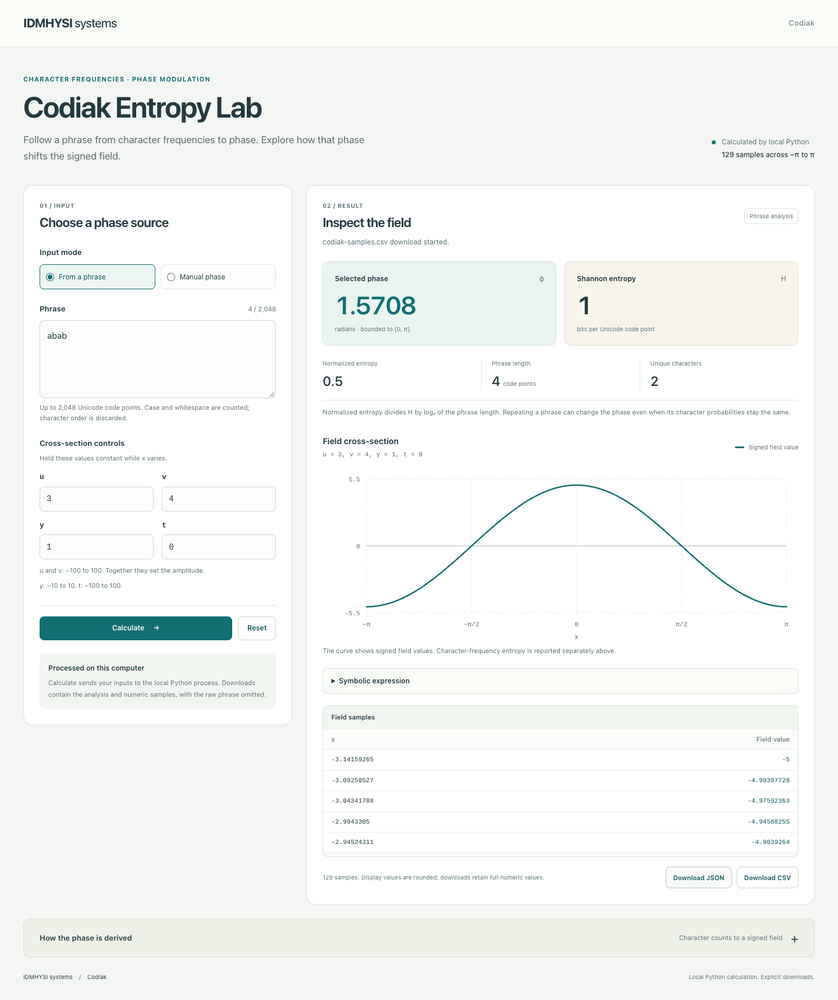

# Codiak Entropy Lab

A local workbench for exploring character-frequency entropy and phase modulation.
Enter a phrase or set a phase directly, see how it shifts a sine-based field, and
download the numerical samples. The browser, command line, and Jupyter notebook
share one Python calculation core.

Developed by **IDMHYSI systems** as part of the **Codiak Core 0.3 Initiative**.

## Start the browser interface

Use Python 3.12.16 or a later security release in the 3.12 series, with pip available
on that interpreter. From the repository root, create a new virtual environment:

```sh
python -m venv --without-pip .venv
python -m pip --python .venv install --require-hashes --only-binary=:all: -r requirements-installer.txt
source .venv/bin/activate
python -m pip install --require-hashes --only-binary=:all: -r requirements.txt
python web.py
```

On Windows PowerShell, activate with `.venv\Scripts\Activate.ps1`.

Open the `http://127.0.0.1:...` address printed in the terminal. The application
chooses an available port; `python web.py --port 8765` selects a particular one.
Keep the process running while you use the page, and press Ctrl+C to stop it.
Node.js is needed only for browser verification, not for running the application.

The interface supports phrase and manual-phase modes, bounded field controls,
an SVG curve with a numerical table, reset, and explicit JSON and CSV downloads.
A calculation runs when requested. Changed inputs invalidate the previous export
so a download describes the displayed calculation.

The browser sends calculations to the Python process on this computer. The
application uses no external service or browser storage. It does not log phrases,
and its responses and exports omit raw phrase text. CSV downloads contain only
numerical samples and fixed column headings.

## Try two phrases

In phrase mode, keep the field controls at their defaults and calculate `ab`,
then `abab`. Both strings split evenly between `a` and `b`, so both have a
Shannon entropy of 1 bit per code point. The lab divides that value by the
log₂ of the phrase length before mapping it to a phase. You should see the
selected phase change from π to π/2 and the curve shift with it. Calculate
`baba` to see why reordering the same characters gives the same result.



## Mathematical behavior

The original signed field is retained:

```text
sqrt(u(x,y,t)^2 + v(x,y,t)^2) * sin(x*y + t + phase)
```

The symbolic functions `u` and `v` remain real-valued. For the browser plot, users
supply constant values for them. The application evaluates 129 samples over
`x = -pi ... pi` using the supplied `y`, `t`, and phase.

The phrase adapter computes Shannon entropy from NFC-normalized Unicode
codepoint counts. With text length `n`, it maps `H / log2(n)` into `[0, 1]`, then
multiplies by pi to obtain the phase. Empty or single-codepoint input gives zero
by convention. This mapping is an explicit addition to the original phase model.

The interface reports character entropy and the signed field separately. The
statistic describes the distribution of code points in the entered text. See
[the mathematical contract](docs/mathematics.md) for the formulas, limits, and
interpretation.

## Command-line and Python use

```sh
python simulation.py
python simulationV2.py --phase 0.75
python simulationV2.py --phase 0.75 --export entropy-export.csv
python simulationV2.py --phrase "abab"
```

The original example prints the zero-phase expression. The v2 default phase is
0.5 radians. `--phrase` derives the phase from the supplied text; it cannot be
combined with `--phase`. The Python core can also be used directly:

```python
from entropy import analyze_phrase, build_expression

analysis = analyze_phrase("abab")
assert analysis["entropy"] == 1.0
assert analysis["normalizedEntropy"] == 0.5
expression = build_expression(analysis["phase"])
print(expression)
```

Phase must be a finite real number from zero to pi. Numeric expressions are never
evaluated from user input. Imports and notebook slider changes do not write files;
`--export`, `export_csv(...)`, or the notebook export button explicitly writes or
overwrites the selected CSV path.

## Interactive notebook

```sh
python -m pip install --require-hashes --only-binary=:all: -r requirements-notebook.txt
python -m jupyterlab CodiakPhraseToEntropySimulationV2.ipynb
```

Run the cells to display the reactive phase slider and export button. Jupyter's
default token authentication remains enabled.

[Launch in Binder](https://mybinder.org/v2/gh/Q29F/CodiakPhraseToEntropy/HEAD?urlpath=lab/tree/CodiakPhraseToEntropySimulationV2.ipynb)

Binder uses `environment.yml` and the pinned notebook dependencies. The remote
Binder build remains unverified. The optional container runs the notebook:

```sh
docker build -f container/Dockerfile -t codiak-entropy .
docker run --rm -p 127.0.0.1:8888:8888 codiak-entropy
```

Open the token-protected URL in the container log. The image uses the official
Python 3.12.16 image on Debian 13, pinned by digest. It installs hash-locked
dependencies and runs as UID 1000. Download files to retain them before stopping
the container. CI builds and exercises the image and verifies the Debian APT,
zlib, and Zstandard patch versions.

## Verify and maintain

Install the notebook requirements for all Python and widget tests:

```sh
python -m unittest discover -s tests -v
python -m nbconvert --to notebook --execute CodiakPhraseToEntropySimulationV2.ipynb --output /tmp/codiak-executed.ipynb --ExecutePreprocessor.timeout=60
```

Browser checks use Node.js 24 and the pinned development dependency:

```sh
npm ci --ignore-scripts
npx playwright install chromium
npm run test:browser
npm audit --audit-level=low
```

CI runs Python checks, notebook execution, real browser interactions, and
advisory scans with read-only repository permissions and pinned action revisions.
It also builds the notebook image and checks its runtime, CLI export, and token
authentication with container networking disabled.
The tests cover mathematics, validation, exports, HTTP framing and authorization,
resource limits, browser controls, and CSP enforcement. The browser test uses the
active `python` executable; `CODIAK_PYTHON` can select another interpreter.

Refresh reviewed dependencies and regenerate their locks with:

```sh
uv pip compile --python-version 3.12 --universal --generate-hashes --no-header requirements.in -o requirements.txt
uv pip compile --python-version 3.12 --universal --generate-hashes --no-header requirements-notebook.in -o requirements-notebook.txt
uv pip compile --python-version 3.12 --universal --generate-hashes --no-header requirements-installer.in -o requirements-installer.txt
```

See [the security boundary](docs/security.md) for the local service controls and
their scope. Dependency scans cover known advisories at the time they run.

## Organization

- `entropy.py`: symbolic field, phase validation, phrase statistics, CSV export.
- `simulation.py` and `simulationV2.py`: command-line and notebook adapters.
- `workbench.py`: validated numerical calculation contract.
- `web.py` and `localServer.py`: application startup and bounded local HTTP transport.
- `ui/`: browser interface, styles, and icon.
- `tests/`: mathematical, interface, transport, and browser regressions.
- `docs/`: mathematical and security contracts.
- `CodiakPhraseToEntropySimulationV2.ipynb`: executable phase notebook.
- `requirements*.in` and `requirements*.txt`: direct dependencies and hashed locks.

## Notice

This research repository is publicly visible and intended for research, testing,
and internal development. Unauthorized copying, distribution, or public
deployment is prohibited.
